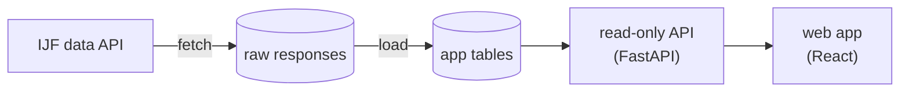

# Judogg


**Which judo techniques actually score at the top level?** Judogg is an "op.gg for judo": it reads the public results of the International Judo Federation (IJF) and shows which techniques score among senior athletes, by weight category, since 2017.

It is a personal, non-commercial project by a judoka, built to learn and to answer questions like "what scores the most at −73 kg?" or "how does this athlete win?".

## Features

- **Techniques**: the techniques that score the most, with the share of ippon, waza-ari and yuko, left/right side, timing in the contest, the trend over the years, a heatmap by weight category and how contests end.
- **Technique**: one technique in depth: by weight category, country and athlete, what else its scorers use, what scores against it, and every score with its contest.
- **Repertoire**: which techniques the same athletes also score with, and which pairs go together.
- **Penalties**: shido reasons and their groups, timing, weight categories, and what the first, second and third shido are given for.
- **Judoka**: one athlete's techniques, their scores on video and similar athletes.
- **Coverage**: which competitions are included, which are excluded and why, and the data quality.

Every page follows the same filters (gender, weight category, years, ruleset, country, side, standing or ground), kept in the URL so a view can be shared. Every number explains itself, and results based on too few contests are greyed out instead of hidden.

## How it works



- `fetch` downloads the IJF answers as they are and stores them.
- `load` rebuilds every app table from the stored answers in one transaction, so a corrected result replaces the old one.
- `backend/` is one Python project: `judogg.ingestion` (the two commands above), `judogg.app` (the API) and `judogg.db` (the shared tables). Import rules keep the business logic free of frameworks.
- `frontend/` is React + TypeScript (Vite), with hand-made charts.
- Everything runs in Docker Compose. It is a development setup only.

## Getting started

Requirements: Docker with Compose and `make`. The Makefile uses `docker compose` and falls back to `docker-compose`.

```bash
cp .env.example .env
make up        # database, API on :8000, frontend on :5173
make migrate   # create the schemas
make load      # load the example competitions used by the tests (Guadalajara 2025, Paris 2026)
```

- App: http://localhost:5173
- API documentation: http://localhost:8000/docs

The first `make up` builds the backend image and installs the frontend packages, so it takes a few minutes.

## Load real IJF data

`make fetch` downloads competitions from the IJF API and stores the raw answers in the database. `--load` then rebuilds the app tables from everything stored.

```bash
make fetch ARGS="--competition 3131 --load"               # one competition, by id
make fetch ARGS="--year 2025 --elite-only --load"         # one season (elite only): Grand Slam, Grand Prix, etc.
make fetch ARGS="--year 2017-2026 --elite-only --load"    # whole history (elite only): skips untagged Opens & Cups
make fetch ARGS="--recent-months 12 --elite-only --load"  # refresh: the IJF corrects results for months
```

| Option | Effect |
| :--- | :--- |
| `--year` | competitions of these years: `2025`, `2025,2026` or `2020-2026` (from 2017) |
| `--elite-only` | download only elite competitions (Grand Slam, Grand Prix, World/Continental Championships, Masters, Olympics), skipping untagged Opens and Cups |
| `--competition` | one competition by id, repeatable. It is downloaded as asked, without the filters below |
| `--recent-months N` | competitions that started in the last N months, always downloaded again |
| `--force` | download again calls that are already stored |
| `--delay S` | seconds between calls (default `FETCH_DELAY_S`, 1 s) |
| `--load` | run `load` at the end, only if no call failed |

How it works:
- It downloads the competitions list first. Then, for each competition, it downloads its categories and one call per category with all its contests and events.
- `--year` and `--recent-months` keep only competitions that are finished, have results and are not excluded by rank or name.
- Calls already stored are skipped, so an interrupted download resumes when you run the same command again.
- A failed call is retried twice (after 2 s and 5 s), then reported. The download goes on, the command exits with 1 and `--load` is skipped. Run it again to retry what failed.
- Timeouts and retries come from `FETCH_TIMEOUT_S` and `FETCH_RETRIES` in `.env`.

To find competition ids, list the stored competitions of a year (the current year by default). The list comes with `make load` and is refreshed by every `fetch`:

```bash
make competitions YEAR=2026
```

The example data of `make load` (Guadalajara 2025, Paris 2026 and two Opens) is stored like a download, so `fetch` would skip those calls and keep the old copies. Add `--force` to your first real download: nothing else is stored yet, so it costs nothing extra.

To rebuild later from what is stored, use `make reload`, not `make load`: `make load` imports the example files again over the real data (to undo it, fetch competitions 3081, 3131, 1439 and 2942 again with `--force`).

How `load` works:
- It rebuilds every app table from all stored responses in one transaction. If it fails, the previous data stays.
- Downloading a competition again replaces its stored answers. Anything the IJF removed (corrected results) disappears at the next load.
- At the end it prints a summary: rows per table, excluded competitions per reason, skipped contests, quality issues and unknown tag groups.

Competitions are filtered by their data, not by their level. Kata, ne-waza, team, para (IBSA, Paralympic) and deaf events are excluded by rank or name (`backend/seeds/exclusions.yaml`). Data before 2017 is ignored. A competition without events, or with technique tags on less than 70% of its scores, is excluded too: this is usual for Opens and continental championships. The Coverage page lists what was included and what was excluded.

## Everyday commands

| Command | What it does |
| :--- | :--- |
| `make up` / `make down` | start / stop the stack |
| `make fetch ARGS="…"` | download IJF data (see above) |
| `make competitions YEAR=…` | list the stored competitions of a year, with their ids |
| `make reload` | rebuild the app tables from the stored data |
| `make test` | backend tests (on the `judogg_test` database) and frontend unit tests |
| `make lint` | ruff, mypy `--strict`, import-linter, ESLint, `tsc` |
| `make format` | format the backend code |
| `make openapi` | export the API contract to `frontend/openapi.json` and regenerate the frontend types |
| `make dump` | dump the database to compressed `data/judogg-<timestamp>.sql.gz` |
| `make restore [FILE=...]` | restore the database from the latest dump or a specific file |

CI (`.github/workflows/ci.yml`) runs lint and tests on every push.

## Data source and disclaimer

All competition data comes from the public API of the [International Judo Federation](https://www.ijf.org) (`data.ijf.org`, the data behind [JudoBase](https://judobase.ijf.org)). The data is © International Judo Federation, all rights reserved.

- Judogg is an independent, non-commercial project. It is **not affiliated with, endorsed by or sponsored by the IJF**. "IJF", "JudoBase" and the IJF logos belong to the International Judo Federation.
- Anyone who runs Judogg downloads the data from the IJF API for their own use and should respect the IJF terms of use (in the footer of [ijf.org](https://www.ijf.org)). Downloads are slow on purpose, one call per second by default, to spare the IJF servers.
- Figures are computed from the data as it is, with its gaps and errors (the Coverage page shows them); they are not official IJF statistics.

## License

The code is released under the [MIT License](LICENSE). The license covers the code only, not the IJF data, which remains the property of the International Judo Federation.
